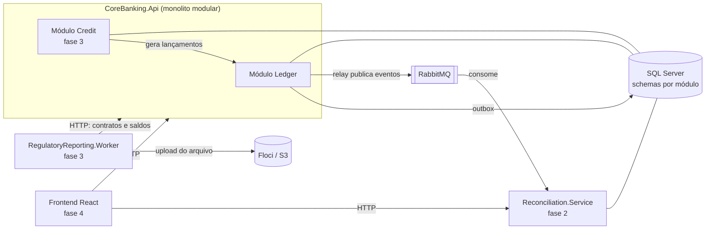

# Core bancário em .NET

Um mini core bancário de portfólio. O núcleo é um **ledger contábil por partidas dobradas**. Os eventos do ledger alimentam uma **conciliação** contra um extrato externo, e um **relatório regulatório de crédito** é gerado a partir de contratos cujos saldos vivem no ledger.

> Todos os dados são fictícios. O relatório regulatório é **inspirado** no layout do Documento 3040 (SCR) do Banco Central, de forma simplificada e **sem nenhuma pretensão de conformidade real**.

## Arquitetura

Arquitetura-alvo, ao fim da fase 3:



- **Monolito modular:** cada módulo tem quatro projetos (`Domain`, `Application`, `Infrastructure`, `Contracts`) e um schema próprio no banco. Um módulo só enxerga o `Contracts` de outro. Ver [ADR 0001](docs/adr/0001-monolito-modular-na-fase-1.md).
- **Ledger:** cada operação gera uma transação contábil cujos débitos e créditos sempre fecham em zero. Tem idempotência por chave, concorrência otimista e outbox gravado na mesma transação.
- **Conciliação:** consome os eventos do ledger via RabbitMQ, com retry e fila de mensagens mortas, e concilia contra um extrato externo fictício.
- **Relatório regulatório:** um Worker Service calcula a posição de crédito por cliente, valida contra a contabilidade e contra um XSD, e envia o arquivo para o S3, emulado localmente pelo Floci ([ADR 0003](docs/adr/0003-floci-como-emulador-de-aws.md)).

## Fases

| Fase | Entrega | Status |
|---|---|---|
| 0 | Estrutura do repositório, CI, compose, ADRs iniciais | ✅ Concluída |
| 1 | Ledger: partidas dobradas, idempotência, concorrência, períodos contábeis, outbox | ⏳ Próxima |
| 2 | Conciliação: RabbitMQ, outbox relay, retry, dead-letter, extração para serviço próprio | — |
| 3 | Crédito e relatório regulatório: Worker Service, validação, XML, upload para S3 | — |
| 4 | Opcional: frontend React + TypeScript e deploy curto na AWS | — |

## Como rodar

**Pré-requisitos:** [Docker Desktop](https://www.docker.com/products/docker-desktop/) e, para desenvolver, o [SDK do .NET 10](https://dotnet.microsoft.com/download).

```bash
docker compose up
```

- A API sobe em `http://localhost:8080`. Health check em `http://localhost:8080/health`.
- O SQL Server fica em `localhost:1433` (usuário `sa`). A senha padrão de desenvolvimento está em [`.env.example`](.env.example). Para trocar, copie o arquivo para `.env`.

Testes:

```bash
dotnet test
```

A partir da fase 1, os testes de integração sobem containers reais (SQL Server, RabbitMQ, Floci) com Testcontainers, então o Docker precisa estar rodando.

## Estrutura

```
src/
├─ Modules/                    um módulo = 4 projetos (ver ADR 0001)
│  └─ Ledger/
│     ├─ CoreBanking.Ledger.Domain
│     ├─ CoreBanking.Ledger.Application
│     ├─ CoreBanking.Ledger.Infrastructure
│     └─ CoreBanking.Ledger.Contracts
└─ Hosts/                      processos executáveis
   └─ CoreBanking.Api          monolito modular
tests/                         testes unitários e de integração
docs/adr/                      decisões de arquitetura
```

Os módulos `Credit` e `Reconciliation`, os hosts `Reconciliation.Service` e `RegulatoryReporting.Worker` e a pasta `tools/` (geradores de dados fictícios) entram nas fases 2 e 3.

Arquivos de raiz que valem para toda a solution:

- `global.json`: versão do SDK e o runner de testes (Microsoft Testing Platform).
- `Directory.Build.props`: `net10.0`, nullable e warnings como erro.
- `Directory.Packages.props`: versões de pacotes centralizadas.
- `.editorconfig`: estilo verificado pelo `dotnet format`.

## Decisões de arquitetura

- [0001 — Monolito modular na fase 1](docs/adr/0001-monolito-modular-na-fase-1.md)
- [0002 — SQL Server como banco de dados](docs/adr/0002-sql-server-como-banco.md)
- [0003 — Floci como emulador de AWS](docs/adr/0003-floci-como-emulador-de-aws.md)
- [0004 — .NET 10 LTS como plataforma](docs/adr/0004-dotnet-10-lts-como-plataforma.md)

## Como o projeto é desenvolvido

- Uma branch por tarefa e pull request com checklist de autorrevisão. A `main` é protegida e exige CI verde.
- Commits no padrão Conventional Commits, em português.
- TDD com xUnit v3.
- O CI roda `dotnet format --verify-no-changes`, build, testes e `docker compose build`.
- Código e identificadores em inglês; documentação em português.
